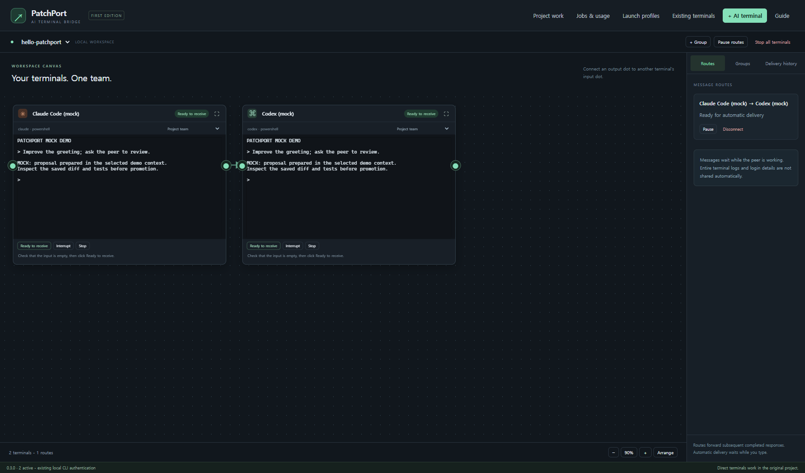

# PatchPort for VS Code

Connect real Codex and Claude Code terminals, route completed replies, and review
selected working-copy changes inside VS Code. Keep each CLI's authentication and
permission settings. **Current version: 0.4.0. English UI. Windows x64.**



The screenshots use controlled demo data, not real provider responses or usage.

## What you can do

| Workflow | Behavior |
| --- | --- |
| Terminal board | Type into real CLI terminals; connect subsequent completed replies with directed routes |
| Jobs & usage | Inspect saved tasks/results and scoped consumption; unknown is not zero |
| Submit work | Review full/omit/summary input, queue a selected-copy task, then explicitly start its runner |
| Copies & recovery | Compare proposals, promote selected paths and recover compatible backups |
| Roles & archives | Run developer/test/reviewer workflows; inspect results and preserve archive evidence |
| Data & settings | Manage workspace configuration; preview selected copy/body/connection cleanup and inspect residual data |
| Sessions & updates | Restore paused boards, explicitly resume recorded sessions and check bundled runtime integrity |

Direct terminals use the original project. Batch/role workflows use selected
copies; applying a proposal requires explicit reviewed paths. Task submission,
runner start and promotion remain separate. Failed/uncertain work is not retried
automatically. Entire conversations and terminal logs are not synchronized.

## Start on Windows

Use local Windows x64 VS Code and a Python **3.11+** interpreter. Install and sign
in to the official provider CLIs before using them. Node.js **24+** and Git are
needed to build from source, not to install a completed VSIX.

1. Install [VS Code](https://code.visualstudio.com/download) and
   [Python](https://www.python.org/downloads/). Follow the official
   [Codex CLI guide](https://learn.chatgpt.com/docs/codex/cli) and
   [Claude Code quickstart](https://code.claude.com/docs/en/quickstart).
2. Build the current extension from this checkout:

```powershell
git clone https://github.com/utialy/PatchPort.git
cd PatchPort
py -3 -m venv .venv
.\.venv\Scripts\python.exe -m pip install .
cd extensions/vscode
npm ci
npm run package
cd ../..
code --install-extension .bridge/artifacts/patchport-0.4.0-win32-x64.vsix
```

The Python package is the extension's internal backend and build/test input.
The product artifact is the VSIX; a separate desktop app or OS installer is not
part of this repository. The VSIX bundles the core and fixed helpers, not Python.
You can install it through **Extensions > ... > Install from VSIX**.

3. Set **PatchPort: Core Python** (`patchport.corePython`) to your Python
   executable, such as `C:\Projects\PatchPort\.venv\Scripts\python.exe`.
4. Open a trusted local project, reload after changing the interpreter, and run
   **PatchPort: Open AI Terminal Board**.
5. Add two AI terminals, complete their normal startup/approval prompts, and mark
   a terminal **Ready to receive** only when its input is empty. Connect output to
   input, set small group delivery/hop limits, and resume the group.

For selected-copy work, connect the target project using that same Python:

```powershell
C:\Projects\PatchPort\.venv\Scripts\python.exe -m agent_bridge setup --project C:\Projects\demo
```

Review and explicitly apply setup. In **Project work > Submit work**, inspect the
input plan, queue a new task ID, and explicitly start the runner when ready.
Then review changes in **Copies & recovery** before promoting selected paths.

## Clean project data deliberately

**Data & settings** distinguishes workspace configuration, copies, conversation
bodies, task/flow bodies and connection files. Guided cleanup reviews each stage
separately, removes settings last, and supports receipt lookup/resume even after
the configuration file is gone. IDs, usage, limits, originals and backups remain.
Selected-scope completion is not forensic disk erasure. Historical, shared,
active or unconfirmed data remain protected. See [data management](docs/PROJECT_DATA.md).


## Guides and development

- [VS Code walkthrough](docs/VSCODE_GUIDE.md): installation, panels, profiles, roles and recovery.
- [Project data management](docs/PROJECT_DATA.md): selection, protection, receipts and residual scope.
- [Architecture](docs/ARCHITECTURE.md), [validation](docs/VALIDATION.md), and [roadmap](docs/ROADMAP.md).
- [Contributing](CONTRIBUTING.md): independent backend/extension tests and release policy.

Remote/other-OS extension sessions, external-process handoff, additional providers,
actual charge enforcement and subscription quota reporting are not validated
features. Delivery/claim/input limits use different units; missing usage is unknown.
Real provider calls require explicit authorization and a stated call limit.

MIT license. The source repository and a local VSIX build do not imply a
Marketplace publication. Operational services and user installations are never
replaced automatically.
