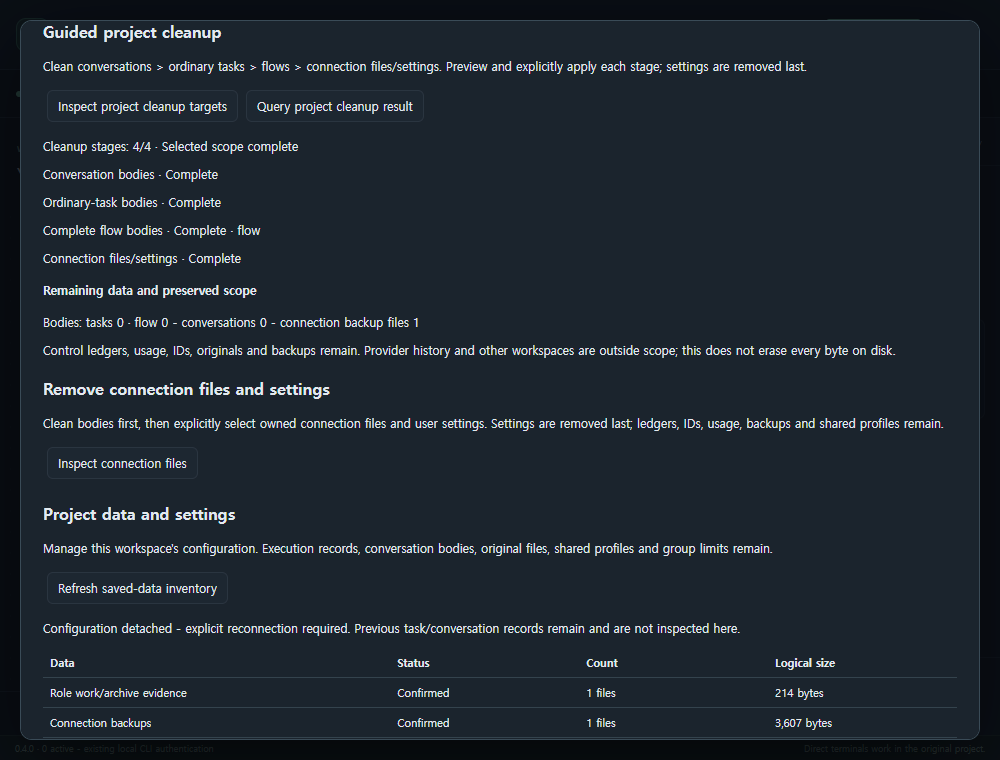

# Project data and settings (0.4.0)

Open **Project work > Data & settings** in the English Windows extension.
Inspection does not start a provider/runner or create/migrate a queue. Unknown
data and incomplete inventories are not zero and do not establish deletion eligibility.

## Workspace configuration

**Refresh saved-data inventory** shows known configuration/ledger paths, counts,
logical sizes and protection reasons. **Reset project cards and routes**, **Attach
default configuration**, **Select configuration and reconnect**, and configuration
detachment affect this workspace's selected project. Other projects, shared group
counts/rounds/limits, records, originals and global profiles remain.

Review a configuration preview before applying it. Detachment also disables
automatic bridge.json fallback. Interrupted snapshot mirroring needs **Finalize
configuration persistence**; this never reruns AI work or resets consumption.

## Copies and bodies

| Target | Explicit action | Preserved/protected scope |
| --- | --- | --- |
| Task/role copies | List, select and preview copy cleanup with retention days | DB answers, IDs, usage and archive evidence remain; active/recovery/changed copies are blocked |
| Conversation bodies | Prepare ledger protection; select up to 100 confirmed-stopped sessions and preview deletion | IDs, usage, delivery counts and provider originals remain; shared delivery needs both sessions |
| Ordinary-task bodies | Prepare ordinary-task ledger protection; select up to 25 newly owned finished tasks | IDs, claims, limits and originals remain; historical/role data are not adopted |
| Complete flow bodies | Additionally prepare role ledger protection; select one new shared flow | Both roles, copies, archives and receipt bodies are handled together; IDs/control remain |
| Connection files/settings | Clean bodies first; separately select owned files and user settings | Settings are last; ledgers, originals, backups, authentication and other projects remain |

Protection preparation is an explicit compatibility change: older writers cannot
use a prepared ledger. Existing historical records are preserved rather than
adopted for deletion. Never bypass an unknown/LOST writer by removing its guard or
using elapsed time/PID guesses. Unsaved editor changes require save/revert and a
new preview. Services, recovery evidence, shared references and incomplete archives
can block deletion. File removal is supported on Windows; other OS deletion is
not established by CI configuration.

Deleted bodies cannot be resumed as provider conversations. Confirmed deletion
clears this host's derived body/output caches; another window's old display,
provider storage, OS backups and forensic SQLite/disk erasure are outside scope.

## Guided project cleanup

1. Click **Inspect project cleanup targets**. Explicitly select conversations,
   ordinary tasks, flows, connection files and user settings. Protection preparation
   uses the existing separate controls; targets are never adopted automatically.
2. Click **Preview selected cleanup scope**. Check the whole order and this stage:
   conversations > ordinary tasks > each flow > connection files/settings.
3. Click **Apply reviewed cleanup stage** and confirm. This applies one stage only.
   The next stage never runs automatically. Settings removal is last; unselected
   remaining bodies block a connection-removal selection before acceptance.
4. Click **Preview next/interrupted cleanup stage**, inspect and explicitly apply
   each subsequent stage. The accepted selection is fixed; newly created data are
   not added silently. Changed data require another review or remain blocked.
5. On an error or lost response, use **Query project cleanup result** first.
   Durable child receipts resolve completed, partial and unaccepted work. Explicit
   resume continues remaining I/O with the original child operation; it never
   reruns a provider or failed task. If only the coordinator receipt is unfinished,
   use **Preview completion-receipt finalization**.
6. If bridge.json is gone or the host restarted, use **Inspect project cleanup
   targets > Query project cleanup result** to rediscover the receipt. Workspace
   detachment and group usage/rounds remain. Querying an old receipt does not undo
   a later explicit reconnection.

One selection is bounded to four conversation ledgers with 100 sessions each,
25 ordinary tasks, eight flows and 64 files. Paginated individual lists can manage
additional records; unlisted rows are preserved. The body-free coordinator receipt
lives at `<state>/project-cleanup.sqlite3`; keep it with the original queue.

**Selected scope complete** requires all child work and the final receipt. File
counts reaching 100% alone do not mean completion. Residual reporting shows body
and connection-backup counts, preserved control/coordinator/original data, and
unknowns. Provider history and other workspaces are not scanned. It does not mean
all project bytes have been erased.

## Connection removal and reconnection

**Inspect connection files** separates manifest-owned hash-matching assets from
user configuration/policy/request files that need separate selection. Modified,
pre-existing or unowned files cannot be adopted. Preview/apply publishes execution
protection and saves workspace detachment before removing files. Configuration is
last; manifest/final receipt failure can leave a partial result after files are gone.

**Query connection-removal result** works without configuration. Repair only the
reported file/metadata problem, then explicitly preview/resume remaining work.
Never remove the queue/guard to make a limit or uncertain outcome disappear.

After completion, prepare a valid configuration at its original path/state and
use **Preview reconnection after removal > Apply reviewed reconnection**.
This releases execution protection without restoring deleted files or starting AI.
Reinstalling needed helpers is a separate explicit setup action.
