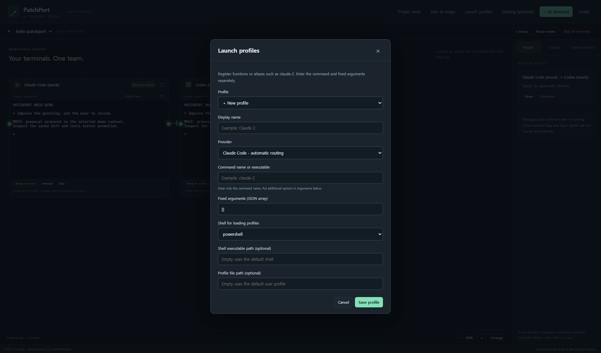
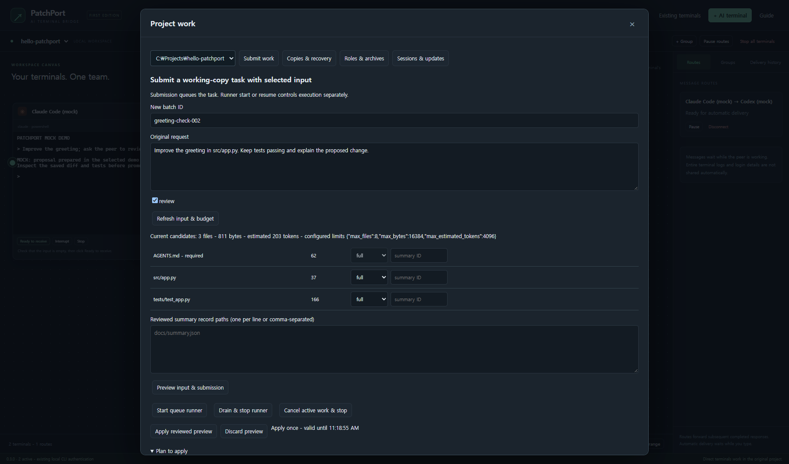
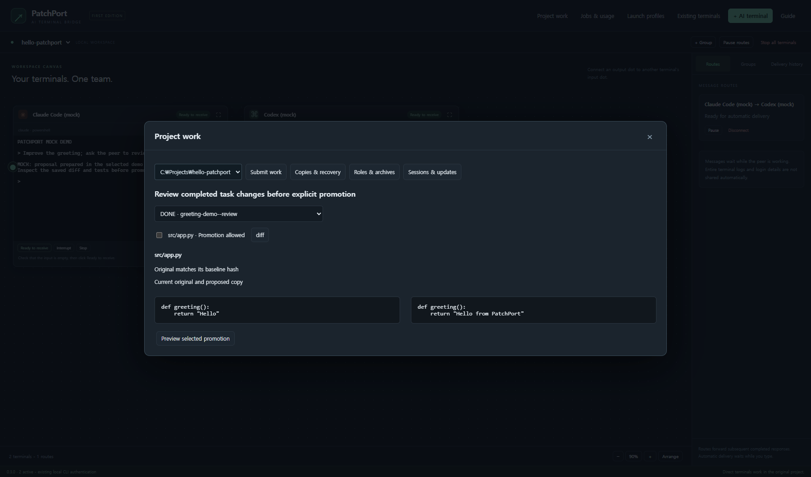
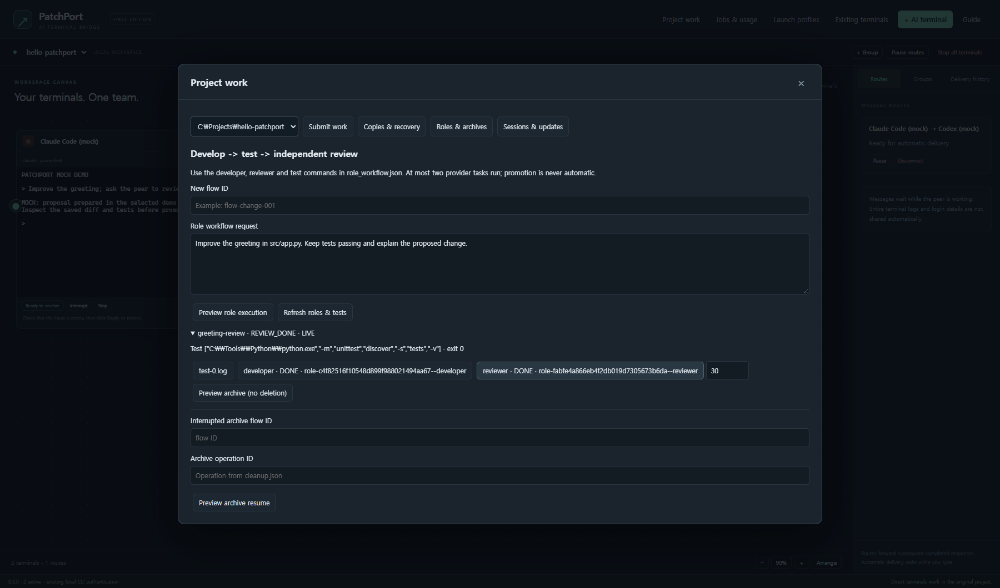
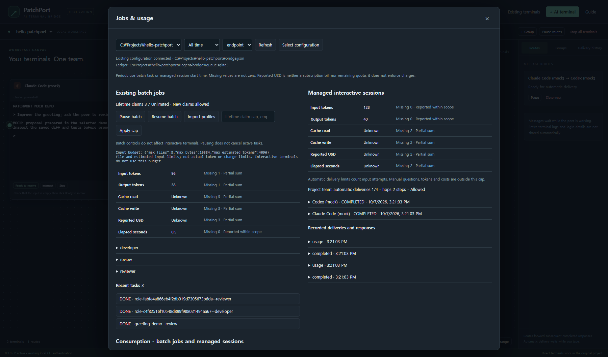
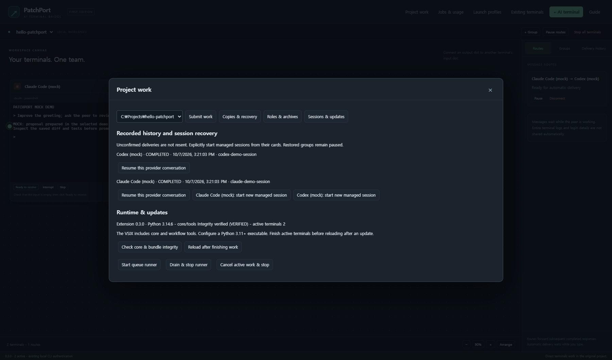

# PatchPort in VS Code: step-by-step guide

## Native builds in 0.5.0

Use a package matching local VS Code's OS and CPU: Windows x64, glibc Linux
x64/ARM64, or macOS Intel/Apple Silicon. Native builds and actual platform
measurements are recorded separately. Remote extension hosts, Remote-WSL and
Alpine/musl are outside this scope.

Default provider shells are Windows PowerShell, Linux Bash and macOS Zsh.
Leave patchport.corePython empty for python on Windows or python3 on Linux/macOS,
or select an absolute Python 3.11+ interpreter. Explicit profiles and existing
provider authentication/permissions are preserved.

Batch/role body removal and connection-file removal, including their guided
cleanup stages, remain Windows-only. Their platform guards are retained; other
platforms can inspect records and use the separate supported workflows.

This guide follows the **English 0.5.0 extension**. Existing screenshots were captured on Windows in 0.4.0 from the actual extension Webview using mock demo data. They show the controls, not a live account, provider response or billing statement.

## 1. Install and check the prerequisites

Follow the [README installation commands](../README.md#start-on-windows) to install the current Python source and build/install the Windows VSIX. Keep the source checkout outside the project you want AI agents to work on.

Check these separately:

| Requirement | How to check | What the check establishes |
| --- | --- | --- |
| Python 3.11+ | Run the selected Python with `--version` | Interpreter version only |
| Node.js 24+ | `node --version` | Build-tool runtime |
| VS Code | Open the local project folder | Editor/workspace availability |
| Provider CLI | Start `claude` or `codex` yourself and finish login | Use the provider's own authentication flow |
| Core binding | Jobs & usage - Refresh | Existing project configuration/database discovery |
| Runtime | Sessions & updates - Check core & bundle integrity | Included core/tools and supported actions |

Set **patchport.corePython** in VS Code Settings to an executable, not a directory or activation script. Example: `C:\Projects\PatchPort\.venv\Scripts\python.exe`. Run the same Python when installing the core and running setup. Changing this setting requires a window reload.

The VSIX includes Python source and fixed workflow helpers. It does not install Python, replace your operational services, or authenticate providers. Open a trusted local folder; an untrusted workspace cannot run terminals or mutations.

## 2. Understand the two ways of running work

**The terminal board** launches real interactive CLIs in the original selected project. You can type, approve tool requests and inspect their normal TUI. An arrow delivers a completed reply to another managed AI terminal. It does not turn that terminal into a protected working copy.

**Project work** uses the existing Python queue and explicitly selected copies. Input selection and submission come first. A runner executes queued tasks. File promotion and recovery happen only after a reviewed preview and explicit confirmation.

Use direct terminals for conversation and normal CLI control. Use Project work when you want a proposed change isolated from the original until you review selected paths. The CLI sandbox remains important in either mode.

## 3. Add terminals and connect them


1. Click **+ AI terminal**.
2. Select the launch profile, project and group. Click **Start terminal**.
3. In the terminal, handle login, startup and permission prompts normally.
4. Add the second AI the same way. Each card belongs to one project and group.
5. Click **Ready to receive** only when its CLI input is empty and ready for a new request. Do not mark an approval prompt as ready.
6. Click the source card's right **Output port**, then the target's left **Input port**. An arrow is directional; use two arrows for a round trip. Both terminals must share a project/group and be AI profiles.
7. Open **Groups**. Set a shared goal if useful, a small **Automatic delivery limit** (for example 2) and **Message hop limit** (for example 2). Resume the group when both peers are ready.
8. Type into one terminal and submit. Click outside the terminal so focus does not defer automatic input. Watch route labels and **Delivery history**.

An arrow does not mean a message has already been delivered. Labels distinguish paused groups, stopped targets, human drafts, focused inputs, busy AIs and exhausted limits. Responses completed while a group is paused are not replayed when it resumes.

**Pause routes** stops automatic routing, not the CLI process. **Interrupt** sends an interrupt to the terminal. **Stop** ends that managed terminal. Closing the board keeps managed terminals alive; ending the extension host ends its owned PTYs.

## 4. Use custom commands or account-specific profiles



Open **Launch profiles** and choose **+ New profile**. Fill in:

- **Display name**: the name shown on the card, for example `Claude review`.
- **Provider**: Claude Code or Codex for automatic AI routes; Ordinary terminal for manual shell work.
- **Command name or executable**: only the executable/command name, for example `claude-2`. Put flags in the next field.
- **Fixed arguments**: a JSON array, for example `["--model", "haiku"]`. Keep existing permission/sandbox options intact.
- **Shell for loading profiles**: choose PowerShell/pwsh/bash/zsh if the command is a function or alias defined in that profile. Direct mode runs a real executable without loading a shell profile.
- **Shell executable / Profile file path**: optional explicit paths. A specified profile file must be absolute.

Save the profile, then select it when adding a terminal. Profiles name commands; they do not collect account tokens or guarantee which account a custom command uses. Authenticate and configure account-specific commands through the official CLI.

**Jobs & usage - Import profiles** can import existing endpoint launch settings from bridge.json after confirmation. Existing VS Code terminals are different: **Existing terminals** can focus them or paste one line without Enter, but cannot collect their output/state or create automatic routes. Check whether the target is a shell or AI before pasting.

## 5. Connect a project for copy-based work

Run setup using your selected installed Python:

```powershell
C:\Projects\PatchPort\.venv\Scripts\python.exe -m agent_bridge setup --project C:\Projects\hello-patchport
```

The setup wizard asks for the project, installed provider commands, input paths and writable paths. Review the preview and explicitly apply it. Existing bridge.json/project rules are preserved; an empty project can use a starter file. Authentication, environments, caches and integration assets are not task input.

Open that same project in VS Code. **Jobs & usage** reads bridge.json without starting a runner or AI. **Select configuration** can choose a different existing config whose project root matches the open folder. Project work requires a connected config. Role workflows require the project's `bridge.json`.

Input paths are what can be copied. Writable paths are what can later be promoted into the original. They do not make the CLI working copy read-only. Keep both lists narrow and inspect provider permissions independently. For setup variants and conflict handling, see [SETUP.md](SETUP.md).

## 6. Select input and submit a task



1. Open **Project work - Submit work** and select the connected project.
2. Enter a unique **New batch ID**, such as `readme-check-001`. A failed/interrupted rerun needs a new ID.
3. Enter the exact **Original request**. Select one or more endpoint checkboxes. A target must exist in bridge.json; board launch profiles and batch endpoints are separate settings.
4. Click **Refresh input & budget**. The table lists the configured input candidates, sizes and required files.
5. Choose `full` to copy a file or `omit` to leave it out. Required rules and required writable input stay full.
6. Click **Preview input & submission**. Review selected/omitted files, target endpoints, bytes, estimates and configured limits. The preview does not queue or start work.
7. Click **Apply reviewed preview** and confirm. This queues the frozen task; it does not start a runner.
8. Inspect pause/claim limits in **Jobs & usage**, then explicitly **Start queue runner** if you want pending tasks to execute.
9. Refresh **Jobs & usage** to read the outcome and retained answer. A `DONE` process outcome is not a judgment that the requested change is correct.

Every preview belongs to the current core connection, expires and is applied at most once. Editing inputs, changing projects, closing the core or detecting changed source/configuration requires a new preview. If a mutation's response is unconfirmed, inspect the queue/results/backups before trying another action.

### Reviewed summaries

A summary is reference data that you have reviewed, not a replacement for the original task or project rules. Use the [reviewed summary format](CONTEXT_SUMMARIES.md) to create a body file and record with source/body hashes, provenance and `reviewed: true`.

In Submit work, list the record paths in **Reviewed summary record paths**. Use mode `summary` and its matching summary ID on the covered source files; use `metadata` on record/body files. Keep required files full. Preview validates every candidate, the record/body/source hashes and the rendered prompt budget. Only full files are copied; reviewed summary text is rendered into the prompt. There is no automatic AI summary generation.

### Limits are different units

The input budget uses file count, UTF-8 bytes and a heuristic token estimate. Optional limits live in bridge.json's `context_budget`; change settings between runs and preview again. A batch claim cap is a lifetime start count. A route delivery cap is an automatic input-attempt count. Neither is a provider token quota or a charge ceiling.

## 7. Inspect a copy, promote paths and recover



1. Open **Copies & recovery** and select a terminal batch task. Failed task copies can also be inspected; active tasks cannot be promoted. Use Roles & archives for role tasks.
2. Click **diff** next to a changed path. The left side is the current original; the right side is the proposed saved copy. A changed original is marked as a conflict. Binary or oversized files require separate file inspection.
3. Select only paths marked **Promotion allowed**. Click **Preview selected promotion** and review the paths/hashes.
4. Save or revert overlapping unsaved VS Code edits, including edits in the proposal or configuration. The extension will not silently save your editor buffer.
5. Apply and confirm. Before writing, the core rechecks terminal state, recorded changes, original/proposal hashes and writable paths. A backup and journal retain recovery evidence if an operation is interrupted.
6. Refresh the task selection after applying. Choose its **backup-... recovery preview** to inspect rollback. Apply explicitly only after reviewing it.

Recovery accepts known before/after states. Later incompatible edits, damaged backup data or modified proposals block the operation. A process outcome or reviewer answer is not approval to promote all paths. Keep the backup until you have finished reviewing; cleanup is blocked by active recovery protection.

## 8. Run development, tests and independent review



Prepare `role_workflow.json` in the connected project. For example, with project input that includes `src` and `tests`:

```json
{
  "developer": {
    "adapter": "claude",
    "command": ["claude"],
    "model": "haiku"
  },
  "reviewer": {
    "adapter": "codex",
    "command": ["codex"],
    "sandbox": "read-only"
  },
  "checks": [
    ["python", "-m", "unittest", "discover", "-s", "tests", "-v"]
  ]
}
```

Replace the model/commands/checks with ones that exist on your machine and project. Checks are explicit argument arrays, run in the developer copy with a timeout; they must not modify the developed files. The reviewer must have an explicit read-only policy. See [ROLES.md](ROLES.md) for supported policies.

1. Open **Roles & archives**, enter a new flow ID and a concrete development/review request.
2. **Preview role execution** shows the configured tests, input and maximum of two provider task starts. Review the parent queue's remaining lifetime claim cap too; roles share that cap with normal batch work.
3. Apply and confirm. A separate recorded job performs development, host checks and independent review. It does not automatically promote changes or retry a failed provider task.
4. **Refresh roles & tests** to observe the flow. Read test exit codes and the test log buttons, then inspect the developer/reviewer result. A failed test stops later stages.
5. Select the developer task to inspect changes. Use selected promotion and backup recovery as in the previous section. A review is evidence, not an approval decision.

Closing the board or core connection does not erase the accepted job. Its durable receipt and flow result allow later inspection. If start is unconfirmed, do not launch the same flow again: inspect its existing receipt/result/log and use a new ID for an authorized rerun.

## 9. Keep evidence and clean up deliberately

**Preview role-copy cleanup** checks explicit task identity, retention age, terminal state, live locks and recovery protection. Only an eligible reviewed preview can delete that selected task's artifacts. Changed files or unsaved edits require another preview. Retained answers and usage remain readable after eligible cleanup.

**Preview archive (no deletion)** creates a reviewed, deduplicated evidence snapshot for an eligible finished flow. It preserves originals, queues, call history and live artifacts. This is not whole-flow deletion. Retention protection and running jobs can make a flow ineligible; the preview lists the reasons.

For an interrupted archive, read the flow's `cleanup.json`, enter its exact flow ID and operation ID, and choose **Preview archive resume**. Review and apply explicitly. Changed sources/queues, damaged journals or unknown layouts block resume; do not delete its evidence to force a retry.

Read archived evidence by its logical path and source, for example `src/app.py` with `developer_workspace`, or a test log from `flow_metadata`. The [archive guide](ARCHIVES.md) explains retained evidence and protection states.

## 10. Read results and consumption



**Jobs & usage** provides recent batch tasks, selected saved results, periods/grouping, batch controls, managed interactive sessions and recorded events/deliveries. **Read saved detail** opens the selected retained event.

The board separates batch and interactive usage. The CLI `usage` command reports batch work only. Known numbers may be combined, but missing values remain unknown and incomplete totals are labeled partial. Claude's main transcript tokens, status-line session cost and Codex's supported fresh-rollout signals have different coverage. Whole-account/subagent consumption and subscription remaining quota are not guaranteed.

Pausing batch claims leaves active work running. **Drain & stop runner** waits for active tasks; **Cancel active work & stop** uses explicit cancellation. Stopping a terminal card and stopping the queue runner are different actions.

## 11. Recover sessions and update safely



A new extension host restores cards, paused groups, group round/counts and recorded history. It does not start an AI or resend old/uncertain deliveries. Unfinished records from a previous owner are shown as UNCONFIRMED. A workspace snapshot also preserves the selected config; changed/corrupt snapshots and another window's edits are not silently overwritten.

- **Start new managed session** starts the card's current profile with a new internal session ID.
- **Resume this provider conversation** retrieves an exact recorded provider UUID for this project/card, asks for confirmation, and adds that CLI's resume arguments. End the same conversation in other windows first. Missing IDs, changed providers or conflicting resume flags require a new session or corrected profile.
- Resumption does not replay the old request. When resumed/reset consumption cannot be separated reliably, it remains unknown rather than counting old usage twice.
- **Check core & bundle integrity** validates the included core/tools and required capabilities. An executable missing from corePython or a damaged/old runtime requires correction, not an automatic replacement.
- Install a new VSIX, finish and stop managed terminals, then **Reload after finishing work**. The extension blocks its reload action while owned terminals are running. Board persistence must succeed before this action proceeds.

## Troubleshooting

| What you see | Check or do next |
| --- | --- |
| No project / restricted mode | Open the intended local folder and review workspace trust |
| Python path error | Set corePython to the actual Python 3.11+ executable; install the core in that interpreter and reload |
| No bridge.json | Use setup for copy workflows; direct managed terminals can record sessions without a batch config |
| Wrong project/config | Select a config whose project root matches the open folder |
| Custom alias not found | Choose its profile shell; confirm the alias/function works in that same shell/profile |
| Arrow exists but no delivery | Check group pause, edge state, target readiness, focus, new drafts and consumed limits |
| Target waiting for approval | Respond in its CLI; do not mark a permission prompt ready |
| Preview expired or changed | Discard it and preview the current inputs again |
| Unsaved editor / original changed | Save or revert intentionally, inspect the new diff, then preview again |
| Queue remains paused or limit reached | Inspect consumed claims and pending work before explicit resume/cap changes |
| Runner start unconfirmed or mismatched | Inspect runner status and saved launch evidence; do not delete the queue or auto-retry |
| Role tests fail | Read the saved test log; inspect the copy and use a new flow for a rerun |
| Archive protected/interrupted | Inspect listed reasons or use the exact operation's explicit resume preview |
| Board snapshot changed/corrupt/locked | Inspect the saved workspace snapshot and other windows; preserve interrupted files before reopening |
| Usage unknown | The supported signal is missing, reset, resumed or incomplete; this is not zero consumption |
| No provider session ID | Start a new managed session; PatchPort does not scan global conversation histories to guess |

See [validation](VALIDATION.md), [runner management](RUNNER_MANAGEMENT.md), [context](CONTEXT.md) and [usage](USAGE.md) for precise boundaries. The current extension scope is local native desktop use; remote extension hosts, Remote-WSL and external-process handoff remain future work.

## Project data and settings

Open **Project work > Data & settings** in the English Windows extension.
Inspection does not start a provider/runner or create/migrate a queue. Unknown
data and incomplete inventories are not zero and do not establish deletion eligibility.

## Workspace configuration

**Refresh saved-data inventory** shows known configuration/ledger paths, counts,
logical sizes and protection reasons. **Reset project cards and routes**, **Attach
default configuration**, **Select configuration and reconnect**, and configuration
detachment affect this workspace's selected project. Other projects, shared group
counts/rounds/limits, records, originals and global profiles remain.

Review a configuration preview before applying it. Detachment also disables
automatic bridge.json fallback. Interrupted snapshot mirroring needs **Finalize
configuration persistence**; this never reruns AI work or resets consumption.

## Copies and bodies

| Target | Explicit action | Preserved/protected scope |
| --- | --- | --- |
| Task/role copies | List, select and preview copy cleanup with retention days | DB answers, IDs, usage and archive evidence remain; active/recovery/changed copies are blocked |
| Conversation bodies | Prepare ledger protection; select up to 100 confirmed-stopped sessions and preview deletion | IDs, usage, delivery counts and provider originals remain; shared delivery needs both sessions |
| Ordinary-task bodies | Prepare ordinary-task ledger protection; select up to 25 newly owned finished tasks | IDs, claims, limits and originals remain; historical/role data are not adopted |
| Complete flow bodies | Additionally prepare role ledger protection; select one new shared flow | Both roles, copies, archives and receipt bodies are handled together; IDs/control remain |
| Connection files/settings | Clean bodies first; separately select owned files and user settings | Settings are last; ledgers, originals, backups, authentication and other projects remain |

Protection preparation is an explicit compatibility change: older writers cannot
use a prepared ledger. Existing historical records are preserved rather than
adopted for deletion. Never bypass an unknown/LOST writer by removing its guard or
using elapsed time/PID guesses. Unsaved editor changes require save/revert and a
new preview. Services, recovery evidence, shared references and incomplete archives
can block deletion. File removal is supported on Windows; other OS deletion is
not established by CI configuration.

Deleted bodies cannot be resumed as provider conversations. Confirmed deletion
clears this host's derived body/output caches; another window's old display,
provider storage, OS backups and forensic SQLite/disk erasure are outside scope.

## Guided project cleanup

1. Click **Inspect project cleanup targets**. Explicitly select conversations,
   ordinary tasks, flows, connection files and user settings. Protection preparation
   uses the existing separate controls; targets are never adopted automatically.
2. Click **Preview selected cleanup scope**. Check the whole order and this stage:
   conversations > ordinary tasks > each flow > connection files/settings.
3. Click **Apply reviewed cleanup stage** and confirm. This applies one stage only.
   The next stage never runs automatically. Settings removal is last; unselected
   remaining bodies block a connection-removal selection before acceptance.
4. Click **Preview next/interrupted cleanup stage**, inspect and explicitly apply
   each subsequent stage. The accepted selection is fixed; newly created data are
   not added silently. Changed data require another review or remain blocked.
5. On an error or lost response, use **Query project cleanup result** first.
   Durable child receipts resolve completed, partial and unaccepted work. Explicit
   resume continues remaining I/O with the original child operation; it never
   reruns a provider or failed task. If only the coordinator receipt is unfinished,
   use **Preview completion-receipt finalization**.
6. If bridge.json is gone or the host restarted, use **Inspect project cleanup
   targets > Query project cleanup result** to rediscover the receipt. Workspace
   detachment and group usage/rounds remain. Querying an old receipt does not undo
   a later explicit reconnection.

One selection is bounded to four conversation ledgers with 100 sessions each,
25 ordinary tasks, eight flows and 64 files. Paginated individual lists can manage
additional records; unlisted rows are preserved. The body-free coordinator receipt
lives at `<state>/project-cleanup.sqlite3`; keep it with the original queue.

**Selected scope complete** requires all child work and the final receipt. File
counts reaching 100% alone do not mean completion. Residual reporting shows body
and connection-backup counts, preserved control/coordinator/original data, and
unknowns. Provider history and other workspaces are not scanned. It does not mean
all project bytes have been erased.

## Connection removal and reconnection

**Inspect connection files** separates manifest-owned hash-matching assets from
user configuration/policy/request files that need separate selection. Modified,
pre-existing or unowned files cannot be adopted. Preview/apply publishes execution
protection and saves workspace detachment before removing files. Configuration is
last; manifest/final receipt failure can leave a partial result after files are gone.

**Query connection-removal result** works without configuration. Repair only the
reported file/metadata problem, then explicitly preview/resume remaining work.
Never remove the queue/guard to make a limit or uncertain outcome disappear.

After completion, prepare a valid configuration at its original path/state and
use **Preview reconnection after removal > Apply reviewed reconnection**.
This releases execution protection without restoring deleted files or starting AI.
Reinstalling needed helpers is a separate explicit setup action.
